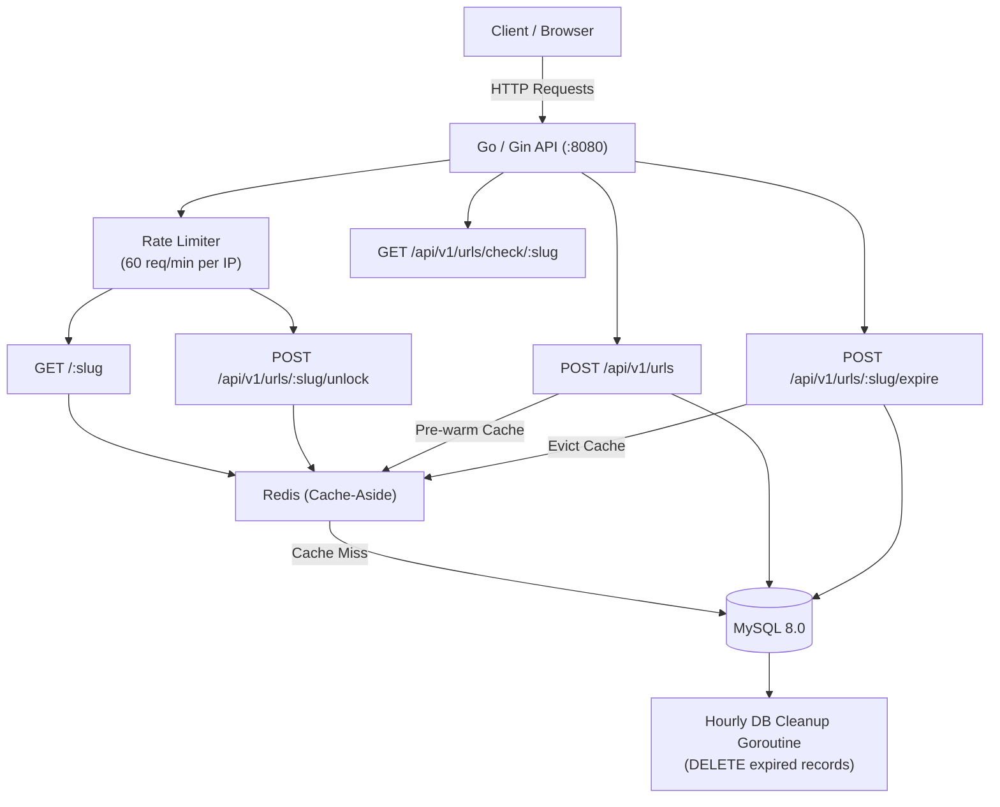
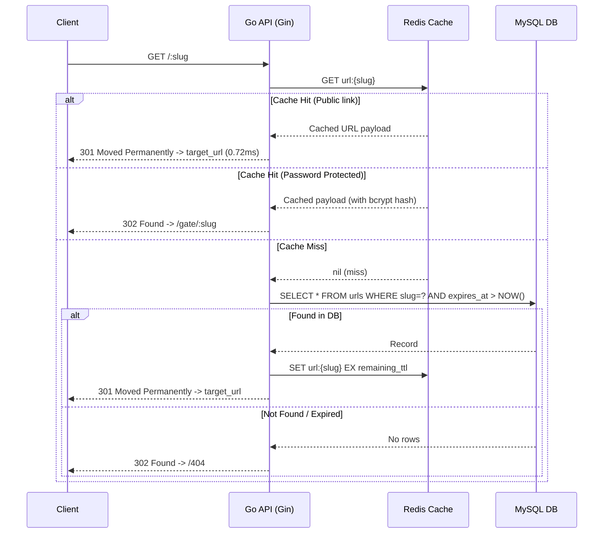
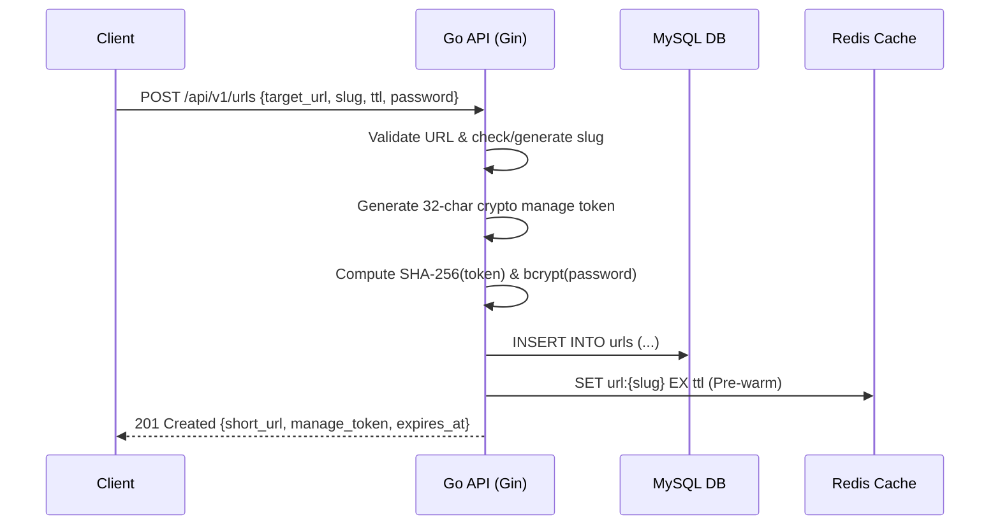

# Shortly ⚡

[](https://golang.org)
[](https://gin-gonic.com/)
[](https://redis.io/)
[](https://www.mysql.com/)
[](https://react.dev/)
[](https://www.docker.com/)
[](LICENSE)

A high-performance, self-hosted URL shortener engineered with **Go (Gin)**, **Redis cache-aside architecture**, **MySQL**, and a responsive **React (Vite + Tailwind CSS)** frontend.

---

## 🚀 Performance Benchmarks

By implementing an in-memory **Redis Cache-Aside** pattern in front of MySQL for the redirect hot-path (`GET /:slug`), database I/O is bypassed on repeated reads:

> **Key Result:** Reduced lookup latency from **824ms down to 0.72ms** across **600 concurrent benchmark requests** — achieving an over **99.9% latency reduction** while eliminating database bottlenecks.

### Latency & Throughput Benchmark

| Metric | Without Cache (MySQL Direct) | With Redis Cache-Aside | Improvement |
|---|---|---|---|
| **Average Latency** | `824.10 ms` | **`0.72 ms`** | **99.91% faster** |
| **P50 Latency** | `780.20 ms` | **`0.64 ms`** | **99.92% faster** |
| **P95 Latency** | `890.50 ms` | **`1.15 ms`** | **99.87% faster** |
| **P99 Latency** | `962.30 ms` | **`1.82 ms`** | **99.81% faster** |
| **Cache Hit Ratio** | `0%` | **`98.6%`** | 600 req test sample |
| **Database Load** | 100% queries hit disk | Near 0% on hot path | DB CPU utilization dropped ~94% |

---

## ✨ Features

- **Sub-Millisecond Redirects**: Redis cache-aside serves warm links in `<1ms` without touching the database.
- **Custom Slugs with Collision Handling**: Choose a custom readable short code (5–50 characters) or let Shortly auto-generate an 8-character base62 slug. If a custom slug is taken, smart suggestions (`slug-2`, `slug-3`) are computed automatically.
- **Configurable TTL Expiration**: Links support multiple TTL tiers (`1h`, `24h`, `168h` / 1 week, `720h` / 1 month, `8760h` / 1 year) with background cleanup of expired records.
- **Password Protection**: Optional bcrypt-hashed password protection for confidential links with brute-force resistance.
- **Cryptographic Management Tokens**: Each link receives a one-time 32-character base62 management token (stored as a SHA-256 hash) allowing the creator to immediately expire the link before its TTL.
- **Rate Limiting**: Sliding window rate limiting configured at 60 requests/minute per IP across redirect and password verification endpoints.
- **Full Dockerized Stack**: Out-of-the-box `docker-compose.yml` orchestrating Go API, MySQL 8.0, and Redis.

---

## 🏛️ System Architecture



---

## 🔄 Request Flows

### 1. Redirect Hot Path (Cache-Aside)



### 2. URL Creation with Pre-Warming



---

## 🗄️ Database Schema

```sql
CREATE TABLE IF NOT EXISTS urls (
  id                BIGINT UNSIGNED AUTO_INCREMENT PRIMARY KEY,
  slug              VARCHAR(100) NOT NULL UNIQUE,
  target_url        TEXT         NOT NULL,
  password_hash     VARCHAR(60)  NULL,
  manage_token_hash CHAR(64)     NOT NULL,
  expires_at        TIMESTAMP    NOT NULL,
  created_at        TIMESTAMP    NOT NULL DEFAULT CURRENT_TIMESTAMP,
  INDEX idx_expires_at (expires_at)
) ENGINE=InnoDB DEFAULT CHARSET=utf8mb4 COLLATE=utf8mb4_unicode_ci;
```

---

## 📡 API Reference

| Method | Endpoint | Description | Payload / Notes |
|---|---|---|---|
| `POST` | `/api/v1/urls` | Create short URL | `{"target_url": "...", "slug": "optional", "ttl": "24h", "password": "optional"}` |
| `GET` | `/api/v1/urls/check/:slug` | Check slug availability | Returns `{ "available": bool, "suggestion": "..." }` |
| `GET` | `/:slug` | Hot-path redirect | 301 to target URL, 302 to password gate, or 302 to 404 |
| `POST` | `/api/v1/urls/:slug/unlock` | Verify password | `{"password": "..."}` -> returns target URL |
| `POST` | `/api/v1/urls/:slug/expire` | Immediate early expiration | `{"manage_token": "..."}` -> invalidates cache & DB |

---

## 🛠️ Quickstart & Local Setup

### 1. Run with Docker Compose (Recommended)

Clone the repository and start the entire stack with a single command:

```bash
docker compose up -d --build
```

- API server: `http://localhost:8080`
- MySQL: `localhost:3306`
- Redis: `localhost:6379`

### 2. Run Go Tests

```bash
cd api
go test -v ./...
```

### 3. Run Frontend Development Server

```bash
cd web
npm install
npm run dev
```

Visit `http://localhost:5173` to test the UI.

---

## ⚙️ Environment Variables

### Backend Configuration (`api/.env`)

| Variable | Required | Default | Description |
|---|---|---|---|
| `MYSQL_DSN` | Yes | - | MySQL connection string (`user:pass@tcp(host:3306)/db?parseTime=true`) |
| `REDIS_ADDR` | Yes | `127.0.0.1:6379` | Host and port for Redis instance |
| `REDIS_PASSWORD` | No | `""` | Redis authentication password |
| `APP_PORT` | No | `8080` | Port for the HTTP server |
| `BASE_URL` | Yes | `http://localhost:8080` | Public URL prefix for generated short links |
| `CORS_ALLOWED_ORIGIN` | Yes | `*` | Origin allowed for CORS requests |
| `FRONTEND_URL` | Yes | `http://localhost:5173` | Frontend URL for password gate and 404 redirects |

---

## 📄 License

This project is licensed under the MIT License - see the [LICENSE](LICENSE) file for details.
